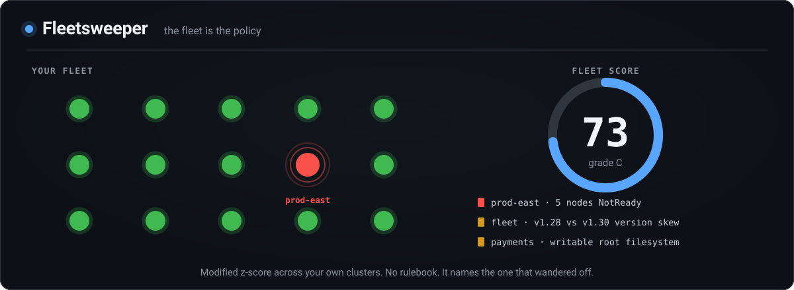

<p align="center">
  
</p>

<p align="center">
  <b>The cluster that drifted is the one that pages you at 3am.</b><br>
  Fleetsweeper finds it before it does.
</p>

<p align="center">
  <a href="https://github.com/dcadolph/fleetsweeper/releases/latest"></a>
  <a href="https://pkg.go.dev/github.com/dcadolph/fleetsweeper"></a>
  <a href="LICENSE"></a>
</p>

<p align="center">
  
</p>

---

You run twelve clusters. Or fifty. Or two hundred. They started identical
and they did not stay that way. Versions skew. Admission policies drift.
Service accounts get patched at 3am and nobody writes it down. Every
cluster is "healthy" on its own, so every tool you already own stays
quiet. Fleetsweeper finds the one cluster that wandered off the herd.

The fleet itself is the baseline. No rulebook. No rules to write.
The [modified z-score](https://en.wikipedia.org/wiki/Median_absolute_deviation)
across your own clusters does the work.

### What you walk away with after one scan

- A **Fleet Score** from 0 to 100 with a one-line headline you can put on a status TV.
- The cluster that is most unlike the rest, plus the exact fields that flagged it.
- **Ranked, leverage-weighted recommendations**. The fix that takes ten clusters from drifted to clean ranks ahead of the same fix on one.
- An optional **admission webhook** that flags pods deviating from your fleet's actual norm, not from a static checklist. It warns by default and never denies until you have read the warnings and opted into enforcement; the [rollout path](docs/operator/admission-webhook.md) is warn first, enforce on purpose.
- One unified stream for inbound signal: scan findings, AlertManager, Falco, Trivy CVEs, Kyverno and Gatekeeper [PolicyReports](https://github.com/kubernetes-sigs/wg-policy-prototypes).

## How scoring works

A scan scores your fleet in two steps.

**1. Find the clusters that differ from the rest.** Every scanner reports
fields per cluster, and each field is compared across the fleet and across
each tagged cohort.

- Numbers (privileged containers, CRD count, pod restarts) use the
  modified z-score, `0.6745 * (value - median) / MAD`. A cluster is flagged
  when that score passes 3.5 in either direction. The median and MAD come
  from your own clusters, so one broken cluster cannot widen the band that
  is meant to catch it.
- Strings (PSA mode, ingress class) flag every cluster off the most common
  value, once that value holds at least 60% of the fleet.
- Lists (installed CRDs) flag a cluster missing any item that at least 60%
  of the fleet has.

What moves the result:

- **Fleet size.** The z-score needs 8 or more clusters. Fleets of 3 to 7 use
  a stricter leave-one-out rule that flags at most one cluster per field and
  caps it at warning. Under 3 clusters nothing is flagged, and the report
  says why.
- **Agreement.** A number most clusters share exactly (MAD of zero) is
  judged like a string. Once one value holds at least 60% of the fleet,
  every cluster off it is flagged, and the finding reads "every other
  cluster in the fleet reports exactly 0" instead of quoting a score. A
  field where no value reaches 60% is skipped. There is no norm to break.
- **Cohorts.** A cluster that matches its own tagged cohort (edge sites,
  say) is not charged for differing from the rest of the fleet.
- **Sensitivity.** `scan --outlier-threshold` and `?threshold=` on
  `/api/outliers` change the 3.5 cutoff. Lower flags more.

**2. Turn what was found into a score.** A flagged field becomes a finding.
Its severity comes from which field drifted, not from how far. Privileged
containers or cluster-admin bindings are critical, node counts are a
warning, and most other fields are info. Direction counts too. A cluster
on the better side of a field where only one direction is bad (fewer
privileged containers than the fleet) is info, titled better than the
norm. A finding that restates another one on the same cluster is dropped,
so one fact is charged once. The Fleet Score starts at 100 and subtracts:

| Cost                                   | Points                             |
|----------------------------------------|------------------------------------|
| Each critical, warning, info finding   | 6, 1.5, 0.25 (capped at 36, 24, 5) |
| Share of clusters in critical status   | Up to 20                           |
| Share of clusters degraded or strained | Up to 10                           |
| Kubernetes minor version skew          | 10 for two or more, 3 for one      |
| Unhealthy nodes in the worst cluster   | Up to 10                           |

The three largest costs come back as the score's drivers, so the number
always arrives with the reason for it.

The details are in [Outliers](docs/concepts/outliers.md) for the detection
math, [Fleet Score](docs/concepts/fleet-score.md) for every cost and cap, and
[Findings](docs/concepts/findings.md#severity-calibration) for how severity
is chosen.

## Consistency is not correctness

The Fleet Score measures one thing: how much your clusters deviate from
each other. It is a consistency number, not a correctness number.

That has a specific failure mode, and you should know it before you put
the number on a TV. If all fifty of your clusters allow privileged pods,
skip resource limits, and run the same end-of-life Kubernetes version,
there is no deviation to find. The fleet agrees with itself, so it scores
well. A uniformly misconfigured fleet looks the same as a uniformly
well-configured one, because the baseline is the fleet, not a standard.

So a Fleet Score of 87 means your clusters mostly agree with each other,
and the drivers name the few places they do not. It does not mean they
are secure, patched, or compliant with anything. Every score also carries
its provenance: how many clusters and scan dimensions produced it, and
how many clusters were excluded for insufficient data. A score built from
six clusters is a weaker claim than one built from sixty, and the report
says which one you are looking at.

A score is also only as good as what the scan could see. A scan that could
not observe a cluster says so and is not graded, and a finding is never
produced from a read that failed.

Fleetsweeper is therefore not a replacement for policy engines, CIS
benchmarks, or vulnerability scanning. Those check clusters against
absolute rules, and they are the tools that catch the failure mode above.
What they cannot catch is the drift and the one-off snowflake cluster
that fleetsweeper exists to find, because nobody wrote a rule for it.
Run both: Kyverno or Gatekeeper for the rules you can write down,
Fleetsweeper for the anomalies you did not know to write a rule for. The
[PolicyReport integration](docs/integrations/policyreport.md) feeds their
violations into the same finding stream, so the pairing is already wired
in.

## See it in 30 seconds

```
go install github.com/dcadolph/fleetsweeper@latest
fleetsweeper serve --demo --addr :8080
```

Open `http://localhost:8080`. A synthetic 26-cluster fleet with six days of
scan history renders with a 3D globe, findings, drift, outliers, capacity,
and a guided tour. No kubeconfig required. The demo is real scan data run
through the real engine, so every number on screen is one the engine
computed. Auth is off in the demo, so the scan trigger, acks, and tags all
work. Real data needs `--auth-token`. The pulsing red dot is the cinematic
part. The outlier detection under it is the real part.

## Install for real

```
helm install fleetsweeper deploy/helm/fleetsweeper \
  --set auth.token=$(openssl rand -hex 32) \
  --set controller.enabled=true
kubectl apply -f deploy/examples/clusterscan-prod.yaml
```

The controller reconciles `ClusterScan` resources and writes outcomes back
to `.status`. Full installation paths in
[`docs/operator/helm.md`](docs/operator/helm.md). Scoped API keys for
pipelines in [`docs/operator/rbac.md`](docs/operator/rbac.md).

## Why this and not what you already have

| You already use            | What it tells you                                | What Fleetsweeper adds                                                              |
| -------------------------- | ------------------------------------------------ | ----------------------------------------------------------------------------------- |
| `kubectl`, k9s             | The state of one cluster, right now.             | A fleet-wide comparison across 24 dimensions. Names the outlier.                    |
| Argo CD, Flux              | Whether each cluster matches its manifest.       | Drift across clusters even when every cluster matches its own source of truth.      |
| Prometheus, Grafana        | Time series for what you remembered to instrument. | Statistical baselines derived from the fleet, with no rules to write.             |
| OPA, Kyverno               | Violations against rules you authored.           | Detects drift you forgot to write a rule for. Complements, does not replace.        |

## Production-ready out of the box

HA backends, leader election, scoped RBAC, audit log, declarative CRDs,
Prometheus and OpenTelemetry, signed reports, backups, GitOps integrations,
admission webhook, and supply-chain signed images. Full checklist:
[`docs/production-readiness.md`](docs/production-readiness.md).

## Where to go next

**Start here**
- [Getting started](docs/getting-started.md). First scan, persistence, history, groups.
- [Architecture](docs/architecture.md). How the pipeline fits together.
- [Scanners](docs/concepts/scanners.md). The 24 dimensions Fleetsweeper checks.

**Concepts**
- [The fleet is the policy](docs/concepts/fleet-is-policy.md). Why norm-based detection scales.
- [Fleet Score](docs/concepts/fleet-score.md). What the number means.
- [Outliers](docs/concepts/outliers.md). MAD-based statistical detection.
- [Distributions](docs/concepts/distributions.md). What a strip shows and how the band is drawn.
- [Findings and remediation](docs/concepts/findings.md). Severity calibration and `kubectl` outputs.
- [Globe view](docs/concepts/globe.md). Geolocation sources and overrides.

**Operator**
- [Overview](docs/operator/overview.md), [Helm](docs/operator/helm.md), [Server mode](docs/operator/server-mode.md)
- [ClusterScan CRD](docs/operator/clusterscan.md), [Leader election](docs/operator/leader-election.md), [Backends](docs/operator/backends.md)
- [RBAC and API keys](docs/operator/rbac.md), [Audit log](docs/operator/audit.md), [OIDC](docs/operator/oidc.md)
- [Admission webhook](docs/operator/admission-webhook.md), [Recommend](docs/operator/recommend.md), [What changed](docs/operator/whatchanged.md)

**Integrations**
- [Prometheus](docs/integrations/prometheus.md), [Slack](docs/integrations/slack.md), [Webhooks](docs/integrations/webhooks.md)
- [PolicyReport](docs/integrations/policyreport.md), [FleetDriftReport](docs/integrations/fleetdriftreport.md)
- [AlertManager](docs/integrations/alertmanager.md), [Falco](docs/integrations/falco.md), [Trivy](docs/integrations/trivy.md)
- [Registry probing](docs/integrations/registry-probing.md)

**Reference**
- [CLI](docs/reference/cli.md), [API](docs/reference/api.md), [Events](docs/reference/events.md)
- [Versioning](docs/reference/versioning.md), [Upgrading](docs/reference/upgrading.md), [Doctor](docs/reference/doctor.md)

## Contributing

Issues and PRs welcome. Start with [`CONTRIBUTING.md`](CONTRIBUTING.md) and
the [code of conduct](CODE_OF_CONDUCT.md). Security disclosures go through
[`SECURITY.md`](SECURITY.md).

## License

MIT. See [`LICENSE`](LICENSE).
